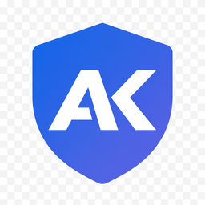

<p align="center">
  
</p>


# Aegis-KeePass OTP Sync

Import TOTP secrets from [Aegis Authenticator](https://getaegis.app/) encrypted backups into [KeePass](https://keepass.info/) entries. Open the desktop app, review matches, and save a merged `.kdbx` database—no plaintext XML export required.

## Overview

This tool connects Aegis (mobile authenticator) and KeePass (password manager) by:

- **Importing** OTP secrets from encrypted Aegis backups (decrypted only in the app's memory)
- **Opening** your KeePass `.kdbx` database directly
- **Matching** Aegis entries to KeePass entries using fuzzy string matching
- **Applying** native KeePass TOTP fields (`TimeOtp-Secret-Base32`, and related settings)
- **Saving** a merged, encrypted `.kdbx` file where you choose
- **Recording** Aegis UUID markers in KeePass Notes to support future re-imports

Designed for single-user use on your own computer. Files are decrypted only in memory for the session, and that session is wiped when you save or end it.

## Install

Download the build that matches your computer from the [latest GitHub Release](https://github.com/wsj-br/aegis-keepass/releases/latest). Replace `<ver>` with the release version (for example `0.1.6`).

| Platform | Asset |
|----------|-------|
| Linux AMD64 | `aegis-keepass-<ver>-linux-amd64.tar.gz` |
| Linux ARM64 | `aegis-keepass-<ver>-linux-arm64.tar.gz` |
| macOS Intel | `aegis-keepass-<ver>-macos-intel.dmg` |
| macOS Apple Silicon | `aegis-keepass-<ver>-macos-arm64.dmg` |
| Windows x64 | `aegis-keepass-<ver>-windows-x64.zip` |
| Windows ARM | `aegis-keepass-<ver>-windows-arm64.zip` |

Pick the row that matches the machine, not the one that is merely newest. An Intel Mac cannot run the Apple Silicon disk image, and a Windows ARM PC needs the ARM zip.

### Linux

The archive contains `aegis-keepass`, plus `LICENSE` and `NOTICES`. The binary does not include GTK or WebKit; install those first (Debian/Ubuntu):

```bash
sudo apt-get install -y \
  gir1.2-gtk-3.0 \
  gir1.2-webkit2-4.1 \
  libgtk-3-0 \
  libwebkit2gtk-4.1-0
tar -xzf aegis-keepass-<ver>-linux-amd64.tar.gz
chmod +x aegis-keepass-*/aegis-keepass
./aegis-keepass-*/aegis-keepass
```

Use the `linux-arm64` archive on ARM. Other distributions need the same GTK 3 and WebKitGTK 4.1 libraries under their own package names.

### macOS

Open the `.dmg` and drag **Aegis-KeePass OTP Sync** onto Applications.

The build is not signed. The first time you launch it, right-click the app, choose **Open**, then choose **Open Anyway** under **System Settings → Privacy & Security** if Gatekeeper still blocks it.

### Windows

Unzip the archive and run `aegis-keepass.exe`. [Edge WebView2 Runtime](https://developer.microsoft.com/microsoft-edge/webview2/) is required and is already installed on most Windows 10 and 11 systems. Use the `windows-arm64` zip on Windows ARM and the `windows-x64` zip on 64-bit Intel or AMD PCs.

## First run

1. **Back up** your KeePass database before you replace it with the merged file.
2. **Open** the app.
3. **Read** your encrypted Aegis backup (`.json`) and KeePass database (`.kdbx`). Enter the Aegis backup password, the KeePass master password, and a keyfile if the database uses one.
4. **Review** automatic matches. Link anything left over by hand, and resolve conflicts before applying changes.
5. **Save** with **Save merged database**. Choose where to write the merged `.kdbx` (the suggested name is `keepass-merged.kdbx`).
6. **End the session** when you are done. Session data is wiped from memory. Open the saved database in KeePass or KeePassXC and confirm the TOTP fields before you retire the backup copy.

## Requirements

| Input            | Format            | Notes                                                                            |
|------------------|-------------------|----------------------------------------------------------------------------------|
| Aegis backup     | Encrypted `.json` | Export from Aegis with encryption enabled; plain JSON backups are not supported  |
| KeePass database | `.kdbx`           | From KeePass 2.x, KeePassXC, or compatible clients                               |
| KeePass keyfile  | Optional          | Required only if your database uses a keyfile in addition to the master password |

## Configuration

These environment variables apply when you run from source (`./scripts/dev`). The packaged app uses the defaults.

| Variable                     | Default              | Description                                                                                                               |
|------------------------------|----------------------|---------------------------------------------------------------------------------------------------------------------------|
| `SESSION_TIMEOUT_SECONDS`    | `1800`               | Idle session timeout in seconds (30 minutes)                                                                              |
| `MAX_IN_MEMORY_UPLOAD_BYTES` | `33554432`           | Combined upload size kept entirely in RAM (32 MB)                                                                         |
| `MAX_UPLOAD_BYTES`           | `52428800`           | Maximum allowed upload size (50 MB)                                                                                       |
| `FLASK_SECRET_KEY`           | *(random per start)* | Secret used to sign session cookies. Set it when you need stable cookies across restarts while developing                |

## How matching works

Matching uses [RapidFuzz](https://github.com/rapidfuzz/RapidFuzz) against KeePass entry titles:

1. Build an Aegis identifier from `issuer` and `name`
2. Score against each KeePass entry title
3. Boost scores using issuer/name substrings, extracted domains, usernames, and numeric tokens
4. Prefer existing `AegisUUID` markers in KeePass Notes when re-importing
5. Flag conflicts when one KeePass entry matches multiple Aegis entries

Entries that do not match automatically can be linked manually in the review step.

## Re-import tracking

Each matched KeePass entry receives an `AegisUUID` marker in its Notes field:

```
Existing notes...

AegisUUID: 00000000-0000-4000-8000-000000000001
```

This enables reliable re-imports: the tool recognises previously linked entries by UUID rather than relying on title matching alone.

## OTP fields written to KeePass

| Field                   | Description                        |
|-------------------------|------------------------------------|
| `TimeOtp-Secret-Base32` | TOTP shared secret (Base32)        |
| `TimeOtp-Period`        | Time step in seconds               |
| `TimeOtp-Digits`        | Number of OTP digits               |
| `TimeOtp-Algorithm`     | Hash algorithm (e.g. `HMAC-SHA-1`) |

These are KeePass 2.x native TOTP fields, compatible with KeePassXC and Keepass2Android.

## Security model

- **Encrypted at rest on your machine** — You open already-encrypted Aegis JSON and `.kdbx` files; decryption happens only in the app's memory during the session
- **In-memory processing** — Typical backups are held in wipeable buffers and never written to disk
- **Secure wipe on session end** — Sensitive buffers are overwritten with random data, then zeroed, when you save or end the session
- **Nothing kept after save** — The merged database is written only where you choose in the Save dialog
- **Loopback only** — The window talks to a Waitress server bound to `127.0.0.1` inside the same process. The app does not listen on your network
- **Offline UI** — CSS, JS, and icons ship inside the app under `app/static/`; the pages do not load fonts or scripts from the internet
- **Session cookies** — HttpOnly and SameSite=Strict; there is no login layer (intended for trusted single-user use)

### Limitations

Memory wiping is best-effort. Python `str` and immutable `bytes` objects cannot be guaranteed erased; the app uses wipeable `SecureBytes` buffers where possible. CPython may copy data internally during cryptography or HTTP handling. This tool is suitable for personal use on your own computer, not for environments that require hardware security modules or formal secret-management guarantees.

Uploads larger than the in-memory threshold (32 MB combined) are encrypted and written to the system temporary directory. Those files are shredded when the session ends.

## Troubleshooting

| Issue | What to try |
|-------|-------------|
| Linux window does not open | Install GTK 3 and WebKitGTK 4.1 (see [Linux](#linux)). A missing typelib usually shows up as a WebKit or `gi` error in the terminal. |
| Windows window does not open | Install the [Edge WebView2 Runtime](https://developer.microsoft.com/microsoft-edge/webview2/). Confirm you unpacked the zip that matches x64 or ARM. |
| macOS says the app cannot be opened | The build is unsigned. Right-click **Open**, then **Open Anyway** in **System Settings → Privacy & Security**. |
| Wrong-architecture download | Use the asset whose name matches your CPU: `linux-amd64`, `linux-arm64`, `macos-intel`, `macos-arm64`, `windows-x64`, or `windows-arm64`. |
| Files rejected | Confirm the Aegis file is an **encrypted** backup and the KeePass file is a valid `.kdbx`. Check file sizes against `MAX_UPLOAD_BYTES`. |
| Wrong password | Aegis and KeePass passwords are checked when you read the files; start again with the correct credentials. |
| Unmatched entries | Link them by hand in the review step. Matching depends on title similarity. |
| Session expired | Idle sessions time out after 30 minutes by default. Start again from the first screen. |

## License

Copyright (c) 2026 Waldemar Scudeller Jr.

Licensed under the [GNU General Public License v3.0](https://www.gnu.org/licenses/gpl-3.0.html). 

